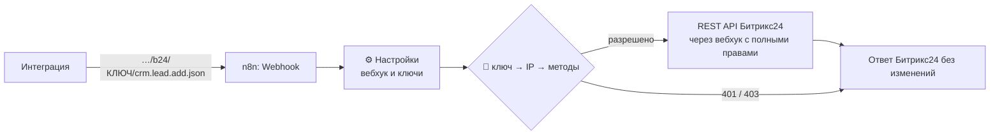

# Гранулярный доступ к REST API Битрикс24 через n8n

Прокси на n8n, который выдаёт каждой интеграции свой ключ. За ключом закреплён список методов Битрикс24 и, если нужно, список IP, с которых его можно использовать. Сам вебхук Битрикс24 с полными правами хранится внутри n8n и никому не передаётся.

```
Форма на сайте → ключ «Сайт» → crm.lead.add                     ✅
                             → crm.deal.list                    ⛔ 403
Телефония      → ключ «АТС»  → crm.activity.add с сервера АТС   ✅
                             → тот же запрос с другого IP       ⛔ 403
```

Для интеграции прокси выглядит как обычный входящий вебхук Битрикс24: запросы и ответы в том же формате. В интеграции меняется только адрес вебхука.

## Проблема

Входящий вебхук Битрикс24 — это URL вида `https://portal.bitrix24.ru/rest/1/abc123…/`. Кто знает этот адрес, тот может вызывать REST API портала. Права вебхука задаются двумя вещами:

1. **Модули (scope):** галочки «CRM», «Задачи», «Пользователи» и так далее при создании вебхука.
2. **Права пользователя**, который создал вебхук.

Отдельные методы выбрать нельзя. Форме на сайте для создания лидов нужен scope `crm`, а с ним вебхук может читать, менять и удалять любые сделки, контакты и компании, то есть выгрузить всю клиентскую базу. Если такой адрес утечёт (взломали сайт, ушёл подрядчик, URL попал в репозиторий или в логи), вместе с ним утекает доступ ко всей CRM.

Обычные способы это ограничить:

| Способ | Минусы |
|---|---|
| Отдельный пользователь с урезанной ролью CRM под каждую интеграцию | Каждый пользователь занимает место в тарифе. Ролевая модель есть не на всех тарифах. Права задаются по сущностям и действиям, а не по методам |
| Приложение из Маркетплейса, которое ограничивает вебхуки | Само приложение получает полный доступ к CRM, то есть доступ доверяется стороннему разработчику |
| Свой прокси-сервис | Его нужно написать, развернуть и поддерживать |

Этот проект — третий вариант, но уже готовый: одно воркфлоу для n8n, которое импортируется за минуту.

## Как это работает



1. Интеграция отправляет запрос на адрес прокси так же, как отправляла бы на вебхук: `…/b24/<КЛЮЧ>/crm.lead.add.json`.
2. Прокси ищет ключ в списке. Если такого ключа нет, отвечает `401`.
3. Если у ключа задан список IP, прокси сверяет с ним адрес клиента. Не совпал — `403`.
4. Прокси проверяет, разрешён ли метод этому ключу. У `batch` проверяется каждая команда внутри.
5. Прокси отправляет запрос в Битрикс24 через настоящий вебхук.
6. Клиент получает ответ Битрикс24 как есть: тот же HTTP-код и то же тело.

Что это даёт:

- **Минимум прав.** Ключ сайта может только `crm.lead.add`, даже если основной вебхук может всё.
- **Привязка к IP.** Ключ работает только с сервера интеграции. Поддерживаются IPv4, IPv6 и подсети.
- **Batch не обходит ограничения.** Запрещённый метод нельзя спрятать внутрь `batch`.
- **Отзыв доступа.** Чтобы отключить интеграцию, достаточно удалить её ключ. Основной вебхук перевыпускать не нужно, остальные интеграции продолжают работать.
- **Совместимость.** GET, POST с JSON, POST в формате form-urlencoded (`fields[TITLE]=…`), с окончанием `.json` и без него.
- **Без лишних пользователей.** Места в тарифе не расходуются.

## Что понадобится

- **n8n**, свой сервер или облако. Проверено на n8n 2.47.4.
- **Права на создание входящего вебхука** в Битрикс24.
- **Reverse proxy перед n8n** (nginx или аналог), который передаёт адрес клиента в `X-Forwarded-For`. Нужен только для ограничения по IP.

## Установка

### Шаг 1. Создайте входящий вебхук в Битрикс24

1. В Битрикс24 откройте **Приложения → Разработчикам → Готовые сценарии → Другое → Входящий вебхук**. Названия пунктов в интерфейсе иногда меняются, актуальный путь есть в [справке Битрикс24](https://helpdesk.bitrix24.ru/open/5408147/).
2. В **Настройке прав** отметьте все модули, которые понадобятся хотя бы одной интеграции, например CRM. Ограничивать доступ дальше будет прокси.
3. Сохраните и скопируйте **Вебхук для вызова REST API**. Это адрес вида `https://ваш-портал.bitrix24.ru/rest/1/abc123…/`.

> Вебхук работает от имени пользователя, который его создал. У этого пользователя должны быть права на всё, что вы потом разрешите ключам. Сам адрес вебхука никому не отдавайте: он будет храниться только в n8n.

### Шаг 2. Импортируйте воркфлоу в n8n

1. Скачайте файл [`b24-granular-proxy.json`](b24-granular-proxy.json) (кнопка **Download raw file**).
2. В n8n создайте новый воркфлоу, откройте меню **…** в правом верхнем углу и выберите **Import from File**. Другой вариант — скопировать содержимое файла и вставить его на пустой холст (Ctrl+V / ⌘V).

> Импортируйте именно через интерфейс. Тогда n8n сам назначит узлу Webhook уникальный ID, и адрес прокси у каждой установки будет свой. Про импорт через CLI — в разделе [Особенности и ограничения](#особенности-и-ограничения).

### Шаг 3. Впишите вебхук и первый ключ

Откройте узел **⚙️ Настройки**. Это единственный узел, который нужно редактировать.

Вставьте адрес вебхука из шага 1:

```js
const B24_WEBHOOK = 'https://ваш-портал.bitrix24.ru/rest/1/abc123…/';
```

Сгенерируйте ключ для первой интеграции:

```bash
openssl rand -hex 24
```

Добавьте интеграцию в `KEYS`. Два примера с `CHANGE_ME` можно удалить: пока ключ в них не заменён, они не работают.

```js
const KEYS = [
  {
    name: 'Сайт — заявки',
    key: '3f1c…',          // результат openssl rand -hex 24
    methods: `
      crm.lead.add
    `,
    ips: `
    `,                      // пусто — с любого IP
  },
];
```

### Шаг 4. Опубликуйте воркфлоу

Нажмите **Publish** (n8n 2.x) или включите переключатель **Active** (n8n 1.x).

> Публиковать нужно после каждого изменения Настроек. Иначе прокси продолжит работать со старой версией.

### Шаг 5. Возьмите адрес прокси

Откройте узел **Webhook Б24** и в блоке Webhook URLs переключитесь на **Production URL**:

```
https://ваш-n8n.ru/webhook/<id>/b24/:key/:method
```

Адрес для интеграции — это часть до `:key` с подставленным ключом:

```
https://ваш-n8n.ru/webhook/<id>/b24/3f1c…/
```

> Если в Production URL указан `localhost`, задайте в окружении n8n переменную `WEBHOOK_URL=https://ваш-n8n.ru/`.

### Шаг 6. Проверьте

```bash
BASE='https://ваш-n8n.ru/webhook/<id>/b24/<КЛЮЧ>'

# Создать лид — разрешено
curl -sS -X POST "$BASE/crm.lead.add.json" \
  -H 'Content-Type: application/json' \
  -d '{"fields":{"TITLE":"Тест прокси","PHONE":[{"VALUE":"+79990000000","VALUE_TYPE":"WORK"}]}}'
# {"result":12345,"time":{…}}

# Прочитать лиды — запрещено
curl -sS "$BASE/crm.lead.list.json"
# {"error":"insufficient_scope","error_description":"Method crm.lead.list is not allowed for this key"}
```

Больше примеров, в том числе запрос в формате form-urlencoded, — в [`examples/curl.sh`](examples/curl.sh). Тестовый лид потом удалите в CRM.

### Шаг 7. Подключите интеграцию

В настройках интеграции (форма сайта, телефония, скрипт, коннектор) замените адрес вебхука Битрикс24 на адрес прокси. Больше ничего менять не нужно.

## Настройка ключей

Каждая интеграция — отдельный объект в `KEYS`:

| Поле | Что задаёт |
|---|---|
| `name` | Название для себя |
| `key` | Секрет интеграции, не короче 24 символов. Ключи с `CHANGE_ME` не принимаются |
| `methods` | Разрешённые методы, по одному на строку или через запятую |
| `ips` | Разрешённые IP и подсети. Пусто — доступ с любого адреса |
| `enabled` | `false` временно отключает ключ (необязательное поле) |

Правила для `methods`:

- **Регистр не важен:** `CRM.LEAD.ADD` и `crm.lead.add` — одно и то же.
- **Маска `crm.lead.*`** разрешает все методы, которые начинаются с `crm.lead.`.
- **`*`** разрешает все методы. Подходит, например, для вашей собственной внутренней системы.
- **`batch` указывать не нужно.** Batch-запрос проходит, только если ключу разрешена каждая команда внутри него. Batch внутри batch запрещён.
- **Строки с `#`** — комментарии.

В `ips` можно указывать отдельные адреса и подсети: `203.0.113.10`, `10.0.0.0/24`, `2a01:4f8::/32`.

### Примеры

```js
// Форма на сайте: только создать лид
{ name: 'Сайт', key: '…', methods: `crm.lead.add` },

// Телефония: найти клиента, создать лид и звонок — только с сервера АТС
{
  name: 'АТС',
  key: '…',
  methods: `
    crm.duplicate.findbycomm
    crm.lead.add
    crm.lead.get
    crm.activity.*
  `,
  ips: `203.0.113.10`,
},

// Выгрузка в BI: только чтение сделок, только из офисной сети
{
  name: 'BI',
  key: '…',
  methods: `
    crm.deal.list
    crm.deal.get
    crm.status.list
  `,
  ips: `10.0.0.0/24`,
},
```

## IP-адрес клиента и reverse proxy

n8n не передаёт воркфлоу адрес соединения, поэтому прокси берёт IP из заголовка, который выставляет ваш reverse proxy. Для nginx перед n8n нужна строка:

```nginx
proxy_set_header X-Forwarded-For $proxy_add_x_forwarded_for;
```

По умолчанию (`IP_HEADER = 'x-forwarded-for'`, `PROXY_HOPS = 1`) берётся последний адрес в цепочке, то есть тот, который дописал ваш nginx. Поэтому подделать адрес, прислав свой `X-Forwarded-For`, не получится.

| Схема | Настройка в «⚙️ Настройки» |
|---|---|
| nginx → n8n | `PROXY_HOPS = 1` (по умолчанию) |
| Cloudflare → nginx → n8n | `PROXY_HOPS = 2` или `IP_HEADER = 'cf-connecting-ip'` |
| nginx с `proxy_set_header X-Real-IP $remote_addr;` | `IP_HEADER = 'x-real-ip'` |

Если определить адрес не удалось, ключи с ограничением по IP получают отказ, а ключи без ограничения работают как обычно.

> **Как узнать, какой IP видит прокси.** Временно укажите у ключа заведомо чужой адрес, например `192.0.2.1`, и отправьте запрос. В ответе будет адрес, который определил прокси: `IP 198.51.100.7 is not allowed for this key`.

## Ответы прокси

| Ситуация | HTTP | `error` |
|---|---|---|
| Неверный или отключённый ключ | 401 | `INVALID_CREDENTIALS` |
| IP не в списке | 403 | `ACCESS_DENIED` |
| Метод не разрешён (в том числе внутри batch) | 403 | `insufficient_scope` |
| Некорректное имя метода | 404 | `ERROR_METHOD_NOT_FOUND` |
| Битрикс24 недоступен | 502 | `BITRIX24_UNAVAILABLE` |
| Всё остальное | как у Битрикс24 | ответ Битрикс24 без изменений |

Ошибки приходят в том же формате, что и у Битрикс24 (`error` и `error_description`), поэтому интеграции и SDK обрабатывают их как обычно.

## Безопасность

- **Основной вебхук** хранится в узле «⚙️ Настройки». Кто получил доступ к n8n, тот получил и вебхук. Защитите вход в n8n и не давайте лишним людям доступ к этому воркфлоу.
- **Ключи передаются в URL**, как и токен вебхука Битрикс24, поэтому попадают в access-логи веб-сервера. Используйте только HTTPS.
- **Журнал запусков.** Воркфлоу не сохраняет успешные запуски (Settings → Save successful production executions = No): в данных запуска видны ключи и адрес вебхука, а запросов через прокси может быть много. Для отладки включите сохранение временно.
- **Если ключ утёк,** замените его в Настройках и опубликуйте воркфлоу. Утёкший ключ даёт доступ только к своим методам и только с разрешённых IP.
- **Параметр `auth`** из запроса отбрасывается. В Битрикс24 запрос всегда уходит через вебхук из Настроек.
- **Имя метода** проверяется по шаблону, поэтому через прокси нельзя обратиться к другим адресам Битрикс24 (например, через `../`).

## Особенности и ограничения

- **Импорт через CLI** (`n8n import:workflow`). В этом случае n8n не назначает узлу Webhook `webhookId`, путь с параметрами `:key/:method` не регистрируется, и запросы получают 404. Перед таким импортом добавьте узлу Webhook в JSON поле `"webhookId": "<любой UUID>"`.
- **Duplicate в n8n.** При копировании воркфлоу n8n заменяет путь узла Webhook на случайный UUID, и `b24/:key/:method` теряется. Для второго экземпляра импортируйте файл ещё раз.
- **Лимит запросов** Битрикс24 у всех ключей общий, потому что все запросы идут через один вебхук.
- **Формат ответа** всегда JSON, даже если запрошен `.xml`.
- **Загрузка файлов через multipart** не поддерживается. В REST Битрикс24 файлы передаются в base64 внутри полей запроса, и так всё работает.

## Частые вопросы

**Нужно ли менять код интеграции?**
Нет, только адрес вебхука.

**Чем это лучше отдельного пользователя с урезанной ролью?**
Не расходуются места в тарифе, права задаются по методам, а не по сущностям, и есть привязка к IP. Подходы можно сочетать: создайте основной вебхук от пользователя с урезанной ролью, и тогда даже ключ с `*` не выйдет за его права.

**Можно ли разрешить всё, кроме удаления?**
Прокси работает только по белому списку. Маска `crm.lead.*` включает и `crm.lead.delete`, поэтому в таком случае перечислите нужные методы явно.

**Почему n8n, а не отдельный сервис?**
n8n часто уже стоит рядом с Битрикс24 для автоматизаций, а прокси настраивается в одном узле без деплоя кода. Логика проверки лежит в [`src/guard.js`](src/guard.js), при желании её можно перенести на любой язык.

## Структура репозитория

```
b24-granular-proxy.json   готовое воркфлоу для импорта в n8n
src/
  config.js               узел «⚙️ Настройки»
  guard.js                узел «🔐 Проверка доступа»: ключ, IP, методы, batch
  response.js             передача ответа Битрикс24 клиенту
scripts/build.mjs         собирает воркфлоу из src/
tests/                    unit-тесты логики и e2e-тесты против настоящего n8n
examples/curl.sh          примеры запросов
```

## Разработка и тесты

Код узлов лежит в [`src/`](src), а `b24-granular-proxy.json` собирается из него:

```bash
npm run build     # src/*.js → b24-granular-proxy.json
npm test          # unit-тесты логики проверки, n8n не нужен (node --test)
```

E2E-тесты прогоняют настоящий n8n с мок-сервером вместо Битрикс24:

```bash
npm run build:test                          # tests/e2e/workflow.test.json: тестовые ключи и фиксированный webhookId
node tests/e2e/mock-bitrix.cjs &             # мок REST API на :9999
n8n import:workflow --input=tests/e2e/workflow.test.json
n8n publish:workflow --id=b24proxye2etest1   # n8n 1.x: update:workflow --id=… --active=true
n8n start &
npm run test:e2e                            # N8N_URL=http://127.0.0.1:5678 по умолчанию
```

С `CHECK_DOWN=1` и остановленным моком дополнительно проверяется ответ 502, когда Битрикс24 недоступен.

## Лицензия

[MIT](LICENSE)
